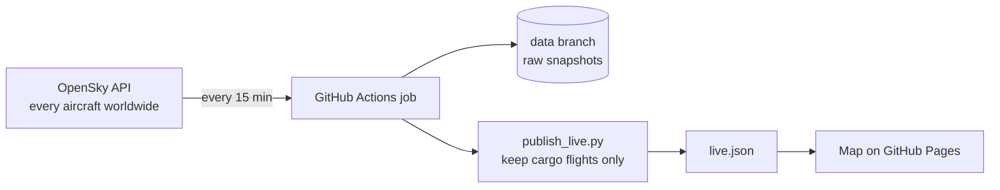

# Live cargo flights worldwide

A live world map of express and cargo airline flights (DHL, UPS, FedEx, ASL and other cargo carriers), built on real aircraft position data from the [OpenSky Network](https://opensky-network.org) API.

**Live map:** https://mintyfizz.github.io/cargo-flight-tracker/

## What it does



1. **Ingest:** every 15 minutes a scheduled GitHub Actions job calls the OpenSky API and downloads the position of every aircraft in the air (about 7,000 at a time).
2. **Store:** the raw snapshot is saved, compressed, on a separate `data` branch, so a history builds up over time for later analysis.
3. **Transform:** `ingest/publish_live.py` identifies cargo flights by their airline code (the first three letters of the callsign, e.g. `BCS` = DHL's European Air Transport, `FDX` = FedEx) using `reference/cargo_operators.csv`, and writes a small, readable `live.json`.
4. **Serve:** the map (`dashboard/index.html`, Leaflet) reloads that file every minute and moves each plane forward along its heading and speed in between, so the map stays live between snapshots.

## Run it locally

```bash
python3 -m venv .venv && source .venv/bin/activate
pip install -r requirements.txt
python ingest/fetch_states.py      # one worldwide snapshot
python ingest/publish_live.py      # cargo flights -> dashboard/data/live.json
cd dashboard && python -m http.server 8000   # open http://localhost:8000
```

## Notes

- **Routes:** click a plane to see where it departed from and where it is going, with a line drawn on the map (solid for the part already flown, dashed for the part ahead). OpenSky does not publish the route of a flight that is still in the air, so the page looks it up by callsign in the free [adsbdb](https://www.adsbdb.com) route database. That is the usual route for the callsign, not a confirmed flight plan: if the plane is nowhere near it, the page says so and draws no line.
- Anonymous OpenSky access allows about 400 credits a day and a worldwide call costs 4, which is why the job runs every 15 minutes. With a free OpenSky account, add `OPENSKY_CLIENT_ID` and `OPENSKY_CLIENT_SECRET` as repository secrets for a higher limit.
- Cargo flights are identified by airline code only. Cargo carried in the hold of passenger flights is not included.
- Data: The OpenSky Network, https://opensky-network.org. Basemap: Esri.
