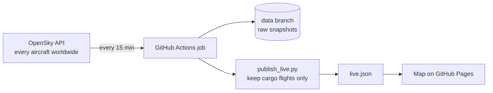

# Live cargo flights worldwide

A live world map of express and cargo airline flights (DHL, UPS, FedEx, ASL and other cargo carriers), built on real aircraft position data from the [OpenSky Network](https://opensky-network.org) API.

**Live map:** https://mintyfizz.github.io/cargo-flight-tracker/

## What it does



1. **Ingest:** every 15 minutes a scheduled GitHub Actions job calls the OpenSky API and downloads the position of every aircraft in the air (about 7,000 at a time).
2. **Store:** the raw snapshot is saved, compressed, on a separate `data` branch, so a history builds up over time for later analysis.
3. **Transform:** `ingest/publish_live.py` identifies cargo flights by their airline code (the first three letters of the callsign, e.g. `BCS` = DHL's European Air Transport, `FDX` = FedEx) using `reference/cargo_operators.csv`, and writes a small, readable `live.json`.
4. **Serve:** the map (`dashboard/index.html`, Leaflet) reloads that file every minute and moves each plane forward along its heading and speed in between, so the map stays live between snapshots.

## Run it locally

```bash
python3 -m venv .venv && source .venv/bin/activate
pip install -r requirements.txt
python ingest/fetch_states.py      # one worldwide snapshot
python ingest/publish_live.py      # cargo flights -> dashboard/data/live.json
cd dashboard && python -m http.server 8000   # open http://localhost:8000
```

## Notes

- **Routes:** click a plane to see where it took off and where it is going, with its flown track drawn as a solid line and the remaining leg as a dashed line. `ingest/routes.py` works this out for every airborne flight:
  - **Departure is measured, not looked up.** The aircraft's own recorded track (open ADS-B data from [adsb.lol](https://adsb.lol)) is followed back to the point where it left the ground, and that point is matched to the nearest airport in `reference/airports.csv` ([OurAirports](https://ourairports.com/data/)). If the track does not reach back to the take-off, the departure is left empty rather than guessed.
  - **Destination is cross-checked.** Aircraft do not broadcast a destination and live flight plans are not open data, so the destination comes from the scheduled route for the callsign in two independent databases ([adsbdb](https://www.adsbdb.com), [hexdb.io](https://hexdb.io)). It is only shown when that scheduled leg starts at the airport the aircraft really took off from and the aircraft is on the way there. Otherwise the map says "destination not confirmed". A diversion after take-off cannot be detected this way.
  - Results are cached per flight on the `data` branch, so each flight costs one track download.
- Anonymous OpenSky access allows about 400 credits a day and a worldwide call costs 4, which is why the job runs every 15 minutes. With a free OpenSky account, add `OPENSKY_CLIENT_ID` and `OPENSKY_CLIENT_SECRET` as repository secrets for a higher limit.
- Cargo flights are identified by airline code only. Cargo carried in the hold of passenger flights is not included.
- Data: positions from The OpenSky Network, https://opensky-network.org. Tracks from adsb.lol. Scheduled routes from adsbdb and hexdb.io. Airports from OurAirports. Basemap: Esri.
