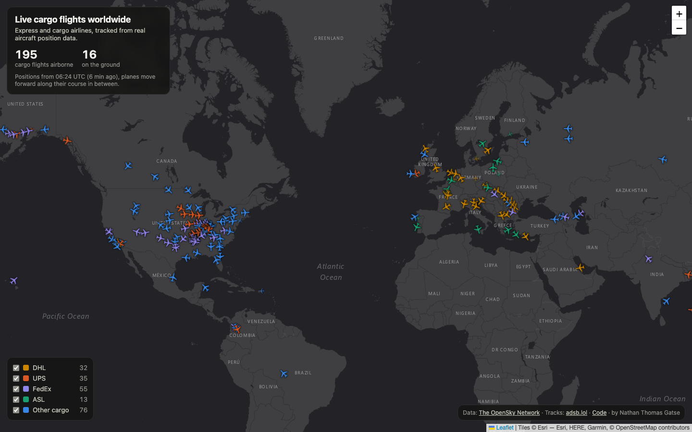
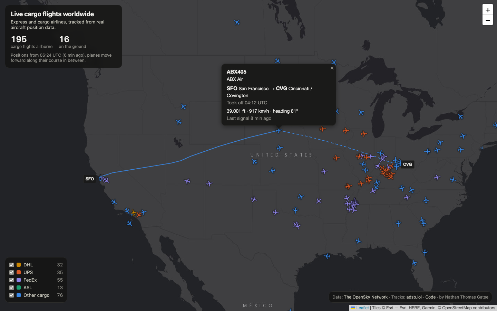
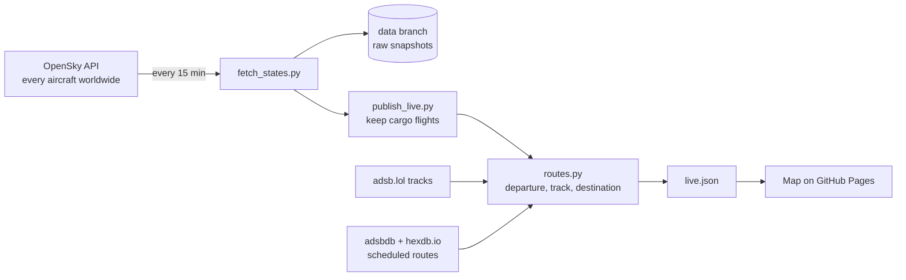

# Live cargo flights worldwide

A live world map of express and cargo airline flights (DHL, UPS, FedEx, ASL and other cargo carriers). Click a plane to see where it took off, the track it has flown, and where it is going.

**Live map:** https://mintyfizz.github.io/cargo-flight-tracker/





Everything runs on free, open data and free hosting: a scheduled GitHub Actions job is the pipeline, a Git branch is the storage, and GitHub Pages serves the map. There is no server to maintain.

## What you see on the map

- Every cargo flight currently in the air (around 300 at a time), coloured by airline group and pointing the way it is flying.
- Click a plane for its callsign, airline, altitude, speed, **departure airport, take-off time and destination**. Its flown track is drawn as a solid line and the remaining leg as a dashed line.
- Switch airline groups on and off in the legend.
- Positions refresh every 15 minutes. In between, each plane moves forward along its heading and speed, so the map keeps moving.

## How it works



1. **Ingest.** Every 15 minutes a GitHub Actions job (`.github/workflows/collect.yml`) runs `ingest/fetch_states.py`, which downloads the position of every aircraft in the air from the [OpenSky Network](https://opensky-network.org) API (several thousand at a time).
2. **Store.** The raw response is saved untouched, compressed, on a separate `data` branch (`states/date=YYYY-MM-DD/HHMMSS.json.gz`). A history builds up over time for later analysis.
3. **Transform.** `ingest/publish_live.py` keeps the cargo flights. A flight is cargo when the first three letters of its callsign are a cargo airline code in `reference/cargo_operators.csv` (e.g. `BCS` = DHL's European Air Transport, `FDX` = FedEx).
4. **Enrich.** `ingest/routes.py` adds the departure airport, flown track and destination to each airborne flight (see below).
5. **Serve.** The result is one small file, `live.json`. The map (`dashboard/index.html`, plain JavaScript with Leaflet) reloads it every minute.

## How routes are worked out

Position data says where a plane is, not where it came from or where it is going. The aim here is to show only what the data supports, and to leave a field empty rather than guess.

**Departure is measured.** The aircraft's own recorded track (open ADS-B data from [adsb.lol](https://adsb.lol)) is followed back to the point where it left the ground. That point is matched to the nearest airport in `reference/airports.csv` (from [OurAirports](https://ourairports.com/data/)). If the track does not reach back to the take-off, or has a gap in which the aircraft could have landed unseen, the departure is left empty.

**Destination is cross-checked.** Aircraft do not broadcast a destination, and live flight plans are not open data. The destination comes from the scheduled route for the callsign in two independent databases ([adsbdb](https://www.adsbdb.com) and [hexdb.io](https://hexdb.io)). It is only shown when:

- the scheduled leg starts at the airport the aircraft really took off from, and
- the aircraft's position is on the way to the scheduled destination, and
- the two databases do not contradict each other.

Otherwise the map says "destination not confirmed" and draws only the flown track.

Measured over the first 4 pipeline runs on 10 November 2026 (981 airborne flights checked): 90% got a measured departure and 59% a confirmed destination. Every run now adds a line to `routes/coverage.csv` on the `data` branch, and the `kpi_route_coverage` table (see below) recomputes these shares over the whole history.

Results are cached per flight on the `data` branch (`routes/cache.json`), so each flight costs one track download.

## Analyse the history

The stored snapshots can be analysed with DuckDB. `run_pipeline.py` runs the three SQL steps in `sql/` and exports the KPI tables as JSON to `data/kpis/`:

| Step | Builds |
| --- | --- |
| `01_staging.sql` | `stg_states`: one row per aircraft per snapshot, flattened from the raw API files |
| `02_flights.sql` | `cargo_states` (cargo aircraft only), `cargo_flights` (consecutive airborne snapshots grouped into flights), `hub_visits` (cargo aircraft at or near a hub from `reference/hubs.csv`) |
| `03_kpis.sql` | `kpi_cargo_share_by_hour`, `kpi_flights_per_operator`, `kpi_busiest_hubs_by_hour`, `kpi_route_coverage` |

```bash
git fetch origin data && git worktree add databranch origin/data   # the full history
RAW_DIR=databranch/states python run_pipeline.py
```

## Project layout

| Path | What it is |
| --- | --- |
| `.github/workflows/collect.yml` | The scheduled job: fetch, store, build `live.json`, deploy the map |
| `ingest/fetch_states.py` | Downloads one worldwide snapshot from OpenSky |
| `ingest/publish_live.py` | Filters cargo flights and writes `dashboard/data/live.json` |
| `ingest/routes.py` | Departure, flown track and destination per flight |
| `dashboard/index.html` | The map |
| `reference/cargo_operators.csv` | Cargo airline codes and the group each belongs to |
| `reference/airports.csv` | About 9,500 airports with coordinates |
| `sql/`, `run_pipeline.py` | DuckDB analysis of the stored snapshots (not used by the map) |
| `reference/hubs.csv` | Cargo hub airports used in the hub analysis |
| `docs/` | Screenshots for this README |

## Run it locally

```bash
python3 -m venv .venv && source .venv/bin/activate
pip install -r requirements.txt
python ingest/fetch_states.py      # one worldwide snapshot
python ingest/publish_live.py      # cargo flights + routes -> dashboard/data/live.json
cd dashboard && python -m http.server 8000   # open http://localhost:8000
```

The first `publish_live.py` run takes about two minutes because it looks up every flight. Later runs only look up flights it has not seen yet.

## Limits

- **Update frequency.** Anonymous OpenSky access allows about 400 credits a day and a worldwide call costs 4, which is why the job runs every 15 minutes. With a free OpenSky account, add `OPENSKY_CLIENT_ID` and `OPENSKY_CLIENT_SECRET` as repository secrets for a higher limit.
- **Diversions.** A flight that diverts after take-off still shows its scheduled destination.
- **Coverage.** Planes are only visible where volunteer receivers pick them up, so flights over oceans and remote regions can be missing or shown at an older position.
- **Cargo only by airline.** Cargo carried in the hold of passenger flights is not included.
- **Track source.** Tracks are read from the data files behind the adsb.lol map, not from a documented API, so this step can break if those files change.

## Data sources

- Aircraft positions: [The OpenSky Network](https://opensky-network.org)
- Aircraft tracks: [adsb.lol](https://adsb.lol)
- Scheduled routes: [adsbdb](https://www.adsbdb.com), [hexdb.io](https://hexdb.io)
- Airports: [OurAirports](https://ourairports.com/data/)
- Basemap: Esri

By Nathan Thomas Gatse.
